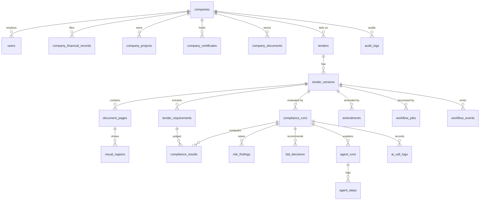

# TenderOps AI — Database Design

Flyway is the single schema source (`server/src/main/resources/db/migration/V1__init.sql`, plus additive
migrations only). Migrations must run on H2 (PostgreSQL-compatibility mode) and PostgreSQL 17: no PG-only
features. JSON fields are TEXT columns mapped with Jackson AttributeConverters (works identically on both).

Conventions: `id BIGINT GENERATED BY DEFAULT AS IDENTITY PRIMARY KEY` (works on H2-PG-mode and PG 17);
money `NUMERIC(19,4)`; timestamps `TIMESTAMP WITH TIME ZONE`; enums as VARCHAR with CHECK constraints.

## ER diagram

## Tables

### users
| Column | Type | Notes |
|---|---|---|
| id | BIGINT identity PK | |
| company_id | BIGINT NOT NULL FK → companies | exactly one company per user |
| email | VARCHAR(320) UNIQUE NOT NULL | login id |
| password_hash | VARCHAR(255) NOT NULL | BCrypt |
| role | VARCHAR(20) NOT NULL CHECK (ADMIN/BID_MANAGER/VIEWER) | |
| created_at | TIMESTAMPTZ NOT NULL | |

### companies
| Column | Type | Notes |
|---|---|---|
| id | BIGINT identity PK | |
| name | VARCHAR(255) NOT NULL | |
| gst_number | VARCHAR(32) | format-validated synthetic in demo |
| gst_registered | BOOLEAN NOT NULL DEFAULT FALSE | |
| msme_registered | BOOLEAN NOT NULL DEFAULT FALSE | |
| blacklisted | BOOLEAN NOT NULL DEFAULT FALSE | |
| is_demo | BOOLEAN NOT NULL DEFAULT FALSE | labels synthetic data |
| data_version | BIGINT NOT NULL DEFAULT 0 | companyDataVersion: bumped on every company-data write |
| created_at / updated_at | TIMESTAMPTZ | |

### company_financial_records
| Column | Type | Notes |
|---|---|---|
| id | BIGINT identity PK | |
| company_id | BIGINT NOT NULL FK | |
| fy_label | VARCHAR(16) NOT NULL | e.g. FY2025-26 |
| fy_end_date | DATE NOT NULL | 31 March |
| turnover | NUMERIC(19,4) | nullable: record may carry only net worth |
| net_worth | NUMERIC(19,4) | nullable |
| currency | VARCHAR(8) NOT NULL DEFAULT 'INR' | non-INR → NEEDS_REVIEW |
| is_audited | BOOLEAN NOT NULL | |
| document_id | BIGINT NULL FK → company_documents | supporting document |
| UNIQUE (company_id, fy_label) | | required by prompt |

Seed rows carry BOTH turnover and net worth per FY (net worth evaluated from latest audited FY).

### company_projects
| Column | Type | Notes |
|---|---|---|
| id | BIGINT identity PK | |
| company_id | BIGINT NOT NULL FK | |
| name | VARCHAR(255) NOT NULL | |
| contract_value | NUMERIC(19,4) | missing → NEEDS_REVIEW for that project |
| currency | VARCHAR(8) NOT NULL DEFAULT 'INR' | |
| status | VARCHAR(20) NOT NULL | COMPLETED / ONGOING / ... (only COMPLETED counts) |
| completion_date | DATE | |
| domain_category | VARCHAR(32) NOT NULL | SMART_CITY / HIGHWAY / ... |
| work_order_doc_id | BIGINT NULL FK → company_documents | |
| completion_cert_doc_id | BIGINT NULL FK → company_documents | documents the "documented set" |

### company_certificates
| Column | Type | Notes |
|---|---|---|
| id | BIGINT identity PK | |
| company_id | BIGINT NOT NULL FK | |
| name | VARCHAR(64) NOT NULL | e.g. CMMI, ISO_9001, ISO_27001, SOLVENCY |
| level_text | VARCHAR(32) | e.g. "Level 3" for CMMI |
| level_number | INTEGER | numeric level for comparison |
| issue_date / expiry_date | DATE | expiry NULL → NEEDS_REVIEW (solvency) |
| amount | NUMERIC(19,4) | solvency threshold amount |
| currency | VARCHAR(8) NOT NULL DEFAULT 'INR' | |
| document_id | BIGINT NULL FK → company_documents | |

Bank Solvency Certificates are rows with name='SOLVENCY'.

### company_documents
| Column | Type | Notes |
|---|---|---|
| id | BIGINT identity PK | |
| company_id | BIGINT NOT NULL FK | |
| file_name | VARCHAR(255) NOT NULL | original name (display only) |
| storage_path | VARCHAR(512) NOT NULL | sha256-based, under data/storage |
| sha256 | CHAR(64) NOT NULL | |
| mime_type | VARCHAR(128) NOT NULL | |
| size_bytes | BIGINT NOT NULL | |
| is_demo | BOOLEAN NOT NULL DEFAULT FALSE | |
| created_at | TIMESTAMPTZ NOT NULL | |

### tenders
| Column | Type | Notes |
|---|---|---|
| id | BIGINT identity PK | |
| company_id | BIGINT NOT NULL FK | owning bidder company (scoping) |
| title | VARCHAR(512) NOT NULL | |
| reference | VARCHAR(128) | tender no. (metadata) |
| created_at | TIMESTAMPTZ NOT NULL | |

### tender_versions
| Column | Type | Notes |
|---|---|---|
| id | BIGINT identity PK | |
| tender_id | BIGINT NOT NULL FK | |
| version_number | INTEGER NOT NULL | 1, 2, ... |
| kind | VARCHAR(16) NOT NULL CHECK (BASE/CORRIGENDUM/FULL_REVISION) | |
| sha256 | CHAR(64) NOT NULL | dedup key (UNIQUE with company scope via tender) |
| storage_path | VARCHAR(512) NOT NULL | |
| page_count | INTEGER NOT NULL | |
| reference | VARCHAR(128) | metadata: tender no. |
| estimated_value | NUMERIC(19,4) | E for 80/50/40 |
| emd_amount | NUMERIC(19,4) | |
| tender_fee | NUMERIC(19,4) | |
| submission_deadline | TIMESTAMPTZ | stored with +05:30 offset |
| UNIQUE (tender_id, version_number) | | |

### document_pages
| Column | Type | Notes |
|---|---|---|
| id | BIGINT identity PK | |
| tender_version_id | BIGINT NOT NULL FK | |
| page_no | INTEGER NOT NULL | 1-based |
| text_content | TEXT | position-sorted extraction |
| classification | VARCHAR(16) NOT NULL | DIGITAL_TEXT / SCANNED / MIXED |
| needs_human_review | BOOLEAN NOT NULL DEFAULT FALSE | |
| review_reason | VARCHAR(64) | OCR_UNAVAILABLE / ... |
| rendered_path | VARCHAR(512) | PNG render path |
| image_width / image_height | INTEGER | render pixel size (for box scaling) |
| extraction_confidence | NUMERIC(5,4) | nullable |
| UNIQUE (tender_version_id, page_no) | | |

### visual_regions
| Column | Type | Notes |
|---|---|---|
| id | BIGINT identity PK | |
| page_id | BIGINT NOT NULL FK → document_pages | |
| region_type | VARCHAR(32) NOT NULL | OFFICIAL_STAMP / HANDWRITTEN_SIGNATURE / TABLE_REGION |
| x0,y0,x1,y1 | NUMERIC(8,6) NOT NULL | normalized top-left origin [0,1] |
| mask_ref | TEXT | raw SAM mask record (best-effort; bbox is mandatory) |
| confidence | NUMERIC(5,4) NOT NULL | |
| source | VARCHAR(24) NOT NULL | SAM_3_1 / FALLBACK_HEURISTIC |
| crop_path | VARCHAR(512) | stamp/table crop PNG |
| region_text | TEXT | extracted raw text (stamp) |
| structured_table | TEXT | JSON cells (table) |
| content_source | VARCHAR(24) | MUSE_VISION / PDFBOX_GEOMETRIC / NULL |

No column, anywhere, records stamp/signature validity or authenticity.

### tender_requirements
| Column | Type | Notes |
|---|---|---|
| id | BIGINT identity PK | |
| tender_version_id | BIGINT NOT NULL FK | merged view lives on the latest version |
| clause_ref | VARCHAR(32) NOT NULL | 4.1, 5.1, ... |
| category | VARCHAR(64) NOT NULL | FINANCIAL / TECHNICAL / CERTIFICATION / DOCUMENT / OTHER |
| mandatory | BOOLEAN NOT NULL DEFAULT TRUE | |
| mandatory_ambiguous | BOOLEAN NOT NULL DEFAULT FALSE | TRUE when defaulted-TRUE under ambiguity |
| metric | VARCHAR(48) NOT NULL | AVG_ANNUAL_TURNOVER / NET_WORTH / SIMILAR_PROJECTS_COUNT_VALUE / SIMILAR_PROJECTS_80_50_40 / CERTIFICATE_VALID / SOLVENCY_CERTIFICATE / OTHER |
| operator | VARCHAR(8) NOT NULL | GTE / GT / LTE / LT / EQ |
| amount_text | VARCHAR(128) | raw text ("Rs. 100 Cr"); Java converts |
| amount_value | NUMERIC(19,4) | parsed INR (nullable if unparseable → NEEDS_REVIEW) |
| currency | VARCHAR(8) NOT NULL DEFAULT 'INR' | |
| count_value | INTEGER | N for count/value |
| lookback_years | INTEGER | NULL = no window |
| domain_tags | VARCHAR(256) | comma list; empty = any |
| certificate_name / certificate_level | VARCHAR(64) / INTEGER | |
| condition_tree | TEXT | JSON AND/OR tree of leaves |
| source_document | VARCHAR(512) NOT NULL | |
| source_page | INTEGER NOT NULL | |
| source_region_id | BIGINT NULL FK → visual_regions | |
| original_quote | TEXT NOT NULL | EXACT raw PDF span (never model paraphrase) |
| quote_verified | BOOLEAN NOT NULL | FALSE → QUOTE_NOT_VERIFIED |
| confidence | NUMERIC(5,4) | model/fallback confidence |
| fingerprint | CHAR(64) NOT NULL | requirementFingerprint for selective re-verify |
| amendment_action | VARCHAR(16) | SUBSTITUTE / INSERT / DELETE / DEADLINE_CHANGE / NONE |
| target_clause_ref | VARCHAR(32) | for corrigenda |

### compliance_runs
| Column | Type | Notes |
|---|---|---|
| id | BIGINT identity PK | |
| tender_version_id | BIGINT NOT NULL FK | |
| company_id | BIGINT NOT NULL FK | |
| company_data_version | BIGINT NOT NULL | snapshot |
| evaluation_context_hash | CHAR(64) NOT NULL | hash(deadline, E, ruleVersion, companyDataVersion) |
| rule_version | VARCHAR(16) NOT NULL | RULE_VERSION constant |
| muse_mode / sam_mode | VARCHAR(16) NOT NULL | LIVE / FALLBACK (H3) |
| readiness_score | NUMERIC(6,2) | |
| decision | VARCHAR(24) | BID / CONDITIONAL_BID / NO_BID / INSUFFICIENT_DATA |
| started_at / finished_at | TIMESTAMPTZ | processingMs = wall clock |
| time_saved_percent | NUMERIC(6,2) | + manual/assisted minutes columns |
| manual_minutes / assisted_minutes | NUMERIC(10,2) | |
| summary_text | TEXT | executive summary (or template fallback) |
| grounding_warning | BOOLEAN NOT NULL DEFAULT FALSE | |

### compliance_results
| Column | Type | Notes |
|---|---|---|
| id | BIGINT identity PK | |
| run_id | BIGINT NOT NULL FK → compliance_runs | |
| requirement_id | BIGINT NOT NULL FK → tender_requirements | |
| verdict | VARCHAR(16) NOT NULL CHECK (PASS/FAIL/UNKNOWN/NEEDS_REVIEW) | |
| reason_code | VARCHAR(64) | e.g. THRESHOLD_NOT_MET, EVIDENCE_MISSING, QUOTE_NOT_VERIFIED |
| calculation_trace | TEXT NOT NULL | JSON: formula, operands (exact strings), threshold, comparison, verdict, ruleVersion, evidenceIds, provenance, contextHash |
| copied_from_run_id | BIGINT NULL | set when selectively copied (TC-AMD-02 asserts this) |

### risk_findings
| Column | Type | Notes |
|---|---|---|
| id | BIGINT identity PK | |
| run_id | BIGINT NOT NULL FK | |
| severity | VARCHAR(16) NOT NULL | CRITICAL / HIGH / MEDIUM / LOW |
| risk_code | VARCHAR(64) NOT NULL | e.g. MANDATORY_FAIL, MISSING_DOCUMENTATION, SUBMISSION_DEADLINE_PASSED |
| source_clause | VARCHAR(32) | |
| evidence_summary | TEXT | |
| detection_reason | TEXT | |
| business_impact | TEXT | |
| corrective_action | TEXT | |

### bid_decisions
| Column | Type | Notes |
|---|---|---|
| id | BIGINT identity PK | |
| run_id | BIGINT NOT NULL FK | |
| recommendation | VARCHAR(24) NOT NULL | BID / CONDITIONAL_BID / NO_BID / INSUFFICIENT_DATA |
| approval_status | VARCHAR(32) NOT NULL | PENDING_HUMAN_APPROVAL / APPROVED_FOR_BID / REJECTED_NO_BID |
| approved_by | BIGINT NULL FK → users | |
| approved_at | TIMESTAMPTZ | |
| warnings | TEXT | JSON (e.g. non-mandatory FAIL warning) |

### amendments
| Column | Type | Notes |
|---|---|---|
| id | BIGINT identity PK | |
| tender_id | BIGINT NOT NULL FK | |
| base_version_id | BIGINT NOT NULL FK → tender_versions | |
| new_version_id | BIGINT NOT NULL FK → tender_versions | |
| diff_json | TEXT NOT NULL | inserted/deleted/modified + threshold/operator/tree/deadline changes |
| prev_decision / new_decision | VARCHAR(24) | transition |
| score_delta | NUMERIC(6,2) | |

### agent_runs / agent_steps
- agent_runs(id, run_id FK → compliance_runs, requirement_id NULL FK, mode LIVE_ORCHESTRATED/FALLBACK_DETERMINISTIC, started_at, finished_at, final_verdict)
- agent_steps(id, agent_run_id FK, step_no, tool_name, input_json, output_json, latency_ms, error_text, created_at)

### workflow_jobs
| Column | Type | Notes |
|---|---|---|
| id | BIGINT identity PK | |
| tender_version_id | BIGINT NOT NULL FK | one ACTIVE job per version enforced in code + partial unique index where supported (H2+PG both support filtered unique index; else code lock) |
| company_id | BIGINT NOT NULL FK | |
| status | VARCHAR(16) NOT NULL | QUEUED / RUNNING / COMPLETED / FAILED |
| current_stage | VARCHAR(16) | VALIDATE/.../DECIDE |
| progress_json | TEXT | per-stage status/progress/error |
| attempt | INTEGER NOT NULL DEFAULT 0 | transient retry counter |
| error_text | TEXT | |
| created_at / updated_at / finished_at | TIMESTAMPTZ | |

### workflow_events
| Column | Type | Notes |
|---|---|---|
| seq | BIGINT GENERATED BY DEFAULT AS IDENTITY PRIMARY KEY | global seq; monotonic per version (single writer) |
| tender_version_id | BIGINT NOT NULL FK | |
| company_id | BIGINT NOT NULL FK | scoping |
| type | VARCHAR(32) NOT NULL | §7.2 event types |
| stage | VARCHAR(16) | nullable stage |
| payload | TEXT NOT NULL | JSON (never secrets, never raw prompts) |
| created_at | TIMESTAMPTZ NOT NULL | |

### ai_call_logs
(id, run_id NULL FK, component MUSE/SAM, model, purpose, status, attempt, latency_ms, ai_mode, error_text, created_at).
Never stores secrets or raw prompts.

### audit_logs (insert-only)
(id, company_id, user_id, action, entity_type, entity_id, before_json, after_json, created_at).
No repository update/delete methods exist for this table; no service code path mutates it (TC-SEC-06 greps this).
