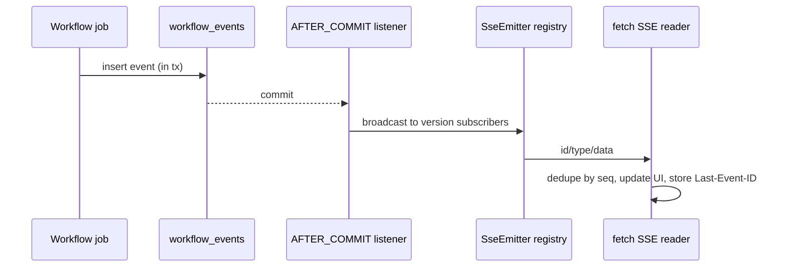

# TenderOps AI — Real-time Design

## Event store (workflow_events)

 Jamaica: seq (identity PK), tender_version_id, company_id, type, stage, payload TEXT, created_at.
- Written in the SAME transaction as the state change they describe.
- Broadcast to live subscribers ONLY in an AFTER_COMMIT listener (TransactionPhase.AFTER_COMMIT, R17).
  A rolled-back transaction therefore emits nothing (TC-RT-04).
- Single writer per version (one active job) → seq is monotonic per version.

## Types & stages (§7.2)

Types: STAGE_STARTED, STAGE_PROGRESS, STAGE_COMPLETED, STAGE_FAILED, PAGE_PARSED, REGION_DETECTED,
REQUIREMENT_EXTRACTED, VERDICT_COMPUTED, RISK_RAISED, DECISION_UPDATED, AI_CALL, AGENT_STEP,
AMENDMENT_STAGE, JOB_COMPLETED, JOB_FAILED.
Stages: VALIDATE, PARSE, RENDER, VISUAL, EXTRACT, VERIFY, RISK, DECIDE.
AI_CALL payload: `{component, model, status, latencyMs, attempt, aiMode}` — never secrets, never raw prompts.

## Endpoints

- `GET /api/v1/tender-versions/{id}/events` → `text/event-stream`. `id:` = seq, `event:` = type,
  `data:` = JSON. Honors `Last-Event-ID` (replays seq > id). Heartbeat `: ping` comment every 15 s.
  Emitters registered per (version, subscriber); removed on disconnect/timeout/error (TC-RT-06).
  Auth: Bearer token required (401 without); cross-company → 404 (no existence leak).
- `GET /api/v1/tender-versions/{id}/events?afterSeq=N` → JSON `{events, lastSeq}` (identical sequence, TC-RT-07).
- `GET /api/v1/dashboard/events` → company SSE for JOB_*/DECISION_UPDATED (+ `?afterSeq=N` JSON).

## Flow

## Client reader contract (see FRONTEND_ARCHITECTURE.md)

fetch() + ReadableStream SSE parser, Bearer header, auto-reconnect with Last-Event-ID, seq dedupe,
polling fallback after 3 failed reconnects, indicator STREAMING | POLLING | DISCONNECTED.

## Time-to-first-event

Measured from job creation to first SSE delivery; target < 1 s; real number reported in TEST_REPORT.md
and BENCHMARK_RESULTS.md (TC-RT-08). First event (STAGE_STARTED/VALIDATE) is emitted synchronously at
job start to keep this small.
