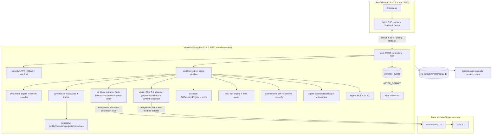
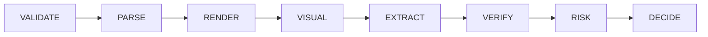

# TenderOps AI — System Architecture

## Component map

## Pipeline stage flow (one workflow job per tender version)

- Each stage emits STAGE_STARTED / STAGE_PROGRESS / STAGE_COMPLETED (or STAGE_FAILED) as persisted events.
- VERIFY emits REQUIREMENT_EXTRACTED (from EXTRACT), VERDICT_COMPUTED per requirement, RISK_RAISED per risk,
  DECISION_UPDATED once; AI_CALL per AI attempt; JOB_COMPLETED/JOB_FAILED at the end.
- Events are written in the same transaction as the state change and broadcast only AFTER_COMMIT (R17).
- Re-Verify runs VERIFY→RISK→DECIDE only (no AI calls). Amendments run the full pipeline for the new version,
  then diff + selective copy at VERIFY.

## Package map (server/src/main/java/com/tenderops)

| Package | Contents |
|---|---|
| common | MoneyUtils, QuoteVerifier, PromptSanitizer, CoordinateUtils, FileSafetyValidator, hashing, Clock config |
| config | Profiles, Jackson (money-as-string), OpenAPI, virtual threads, Meta API properties |
| security | JWT service/filter, RBAC, rate-limit bucket, company scoping |
| audit | Insert-only audit service + entity |
| company | Company, financials, projects, certificates, documents; version bumper |
| tender | Tenders, versions, requirements, compliance runs/results, decisions |
| document | Ingest, classifier, renderer, storage service |
| visual | Sam31Detector, GeometricFallbackDetector, SamOutputParser, table rebuild, crops |
| ai | MuseSparkExtractor, RuleBasedFallbackExtractor, response validation, retry/backoff, grounding check, summaries |
| compliance | Evaluators, condition trees, fingerprints, context hash, re-verify service |
| decision | BidDecisionEngine, readiness score, approval |
| risk | Risk engine, checklist, clarification questions, time-saved metric |
| amendment | Diff, merge, selective re-verification |
| agent | Tool registry + 6 tools, bounded loop, deterministic orchestrator fallback |
| report | PDFBox report, POI XLSX, font loader |
| workflow | Jobs, stage runner, recovery, event store + AFTER_COMMIT broadcaster, SSE |
| demo | PDF generators, ground-truth writer, DemoDataSeeder |
| web | Controllers, DTOs, ProblemDetail handler, demo endpoints |

## Key design rules

- AI boundary: `ai` and `visual` packages are the only callers of the Meta API; every call goes through a
  logged, retried, config-driven adapter that records aiMode. Fallbacks are general algorithms, never golden lookups.
- Determinism boundary: `compliance`, `decision`, `risk` are pure functions of (requirements, company data,
  deadline, estimated value, Clock, rule version). No AI types leak into them.
- Money boundary: money crosses the API only as strings; client never computes with it.
- Truth boundary: tests under `src/test` may use doubles + ground truth; `src/main` never reads golden files.
